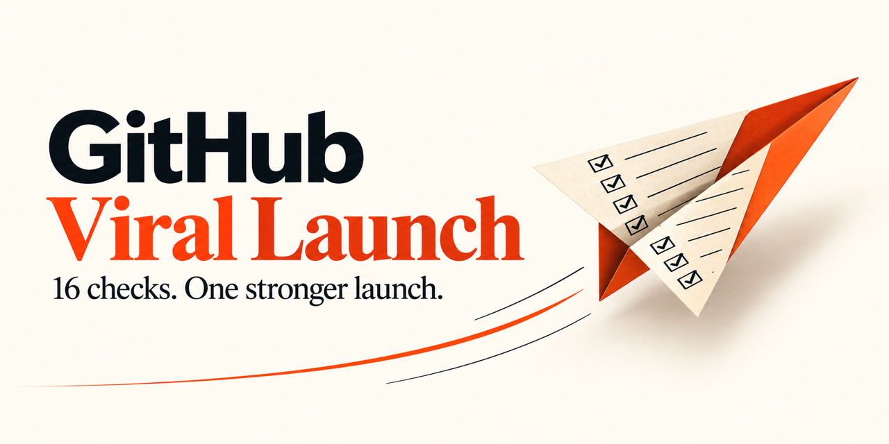
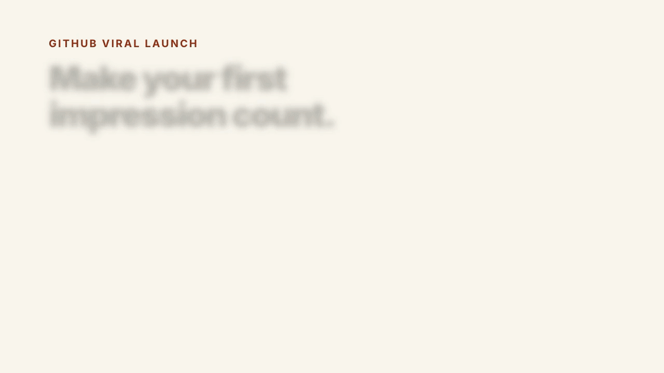

<p align="center"></p>

# GitHub Viral Launch

An agent skill for open-source maintainers: turn 16 launch checks into a repo people can understand, try, trust, and share.

```bash
npx skills add LeonardSEO/github-viral-launch --skill github-viral-launch
```



[](https://github.com/LeonardSEO/github-viral-launch/actions/workflows/validate.yml)
[](LICENSE)

**A stronger launch starts before the announcement.** This skill examines the repo, identifies the highest-value improvements, and prepares a launch around an actual useful result. It pursues organic reach without promising stars or manufacturing engagement.

[Read the skill](skills/github-viral-launch/SKILL.md) · [Watch the 8-second overview](assets/launch.mp4) · [See a worked example](docs/example-audit.md) · [Ask a question](https://github.com/LeonardSEO/github-viral-launch/discussions)

## Use it

You need Node.js/npm for the installer and an agent that supports SKILL.md. The installer lets you select your supported agent; the skill itself needs no API key or runtime dependency. GitHub credentials are needed only for operations that require access to your repositories.

After installation, ask your agent:

```text
Use github-viral-launch to audit https://github.com/OWNER/REPO.
Report all 16 checks with evidence and the smallest useful fix.
Do not change anything.
```

In Codex, you can explicitly invoke `$github-viral-launch`. For implementation:

```text
Use github-viral-launch to improve this repository for launch.
Make the highest-value local improvements and prepare the launch package.
Ask before pushing, changing GitHub settings, or publishing anything.
```

Prefer a global installation? Add `--global`. Prefer a particular agent? Use the installer's `--agent` option; see the [Skills CLI](https://github.com/vercel-labs/skills) for current supported agents. You can also [read SKILL.md directly](skills/github-viral-launch/SKILL.md) before installing.

## What it delivers

- **An evidence-based audit:** PASS, FAIL, UNKNOWN, or NOT APPLICABLE for each launch point.
- **Useful local improvements:** a clear README, a working first-use path, honest contribution guidance, and the smallest relevant fixes.
- **A launch package:** a demonstrable angle, demo plan, social preview, release notes, contributor tasks, channel preparation, and reply coverage.
- **A way to learn:** baseline and day-1/7/30 review of reach, trial, and contributions.

| First impression | Trust and discovery | Participation and launch |
| --- | --- | --- |
| 1. Demo GIF | 5. License | 10. Good first issues |
| 2. One-line description | 6. Repository topics | 11. Contributing guide |
| 3. One-command install | 7. Social preview | 12. Issue templates |
| 4. Immediate trial/demo | 8. Passing CI | 13. Discussions |
| | 9. Secrets/history scan | 14. Tagged release and notes |
| | | 15. Show HN preparation |
| | | 16. Response within a day |

## What makes it different

This is a fixed, inspectable repository launch workflow, with evidence and a smallest fix per check. It distinguishes local assets from live settings, a badge from an actual passing run, and missing evidence from success. It also helps implement improvements when that is what you requested.

A complete checklist cannot guarantee adoption. A missing GIF need not block a release; an exposed credential or broken promised first run needs attention before a traffic push. The animated overview explains the method; the worked audit is explicitly fictional, not a claim of measured results.

For Show HN, it prepares an author facts brief rather than generated submission copy, respecting the [HN guidelines](https://news.ycombinator.com/newsguidelines.html). It never buys stars, coordinates votes, or publishes on your behalf without authorization.

## Contribute

Start with [CONTRIBUTING.md](CONTRIBUTING.md) and the [good first issues](https://github.com/LeonardSEO/github-viral-launch/labels/good%20first%20issue). Useful contributions improve the skill's decisions with a reproducible example, rather than adding generic advice.

## Credits and license

An original synthesis of a 16-point open-source launch checklist, informed by [jonathimer/devmarketing-skills](https://github.com/jonathimer/devmarketing-skills/blob/main/skills/open-source-marketing/SKILL.md) and [samber/developer-relations-skills](https://github.com/samber/developer-relations-skills/blob/main/skills/oss-launch/SKILL.md). Neither is required or bundled.

MIT © 2026 LeonardSEO. Icon and banner generated with OpenAI ImageGen; the editable animation uses [HyperFrames](https://github.com/heygen-com/hyperframes). [Asset provenance](docs/media.md).
